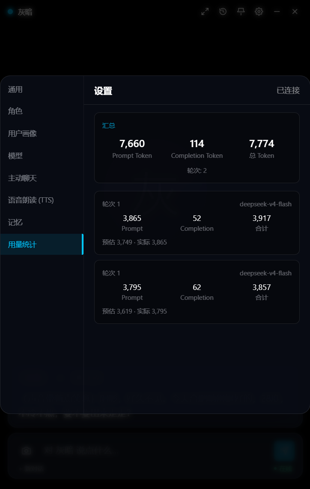
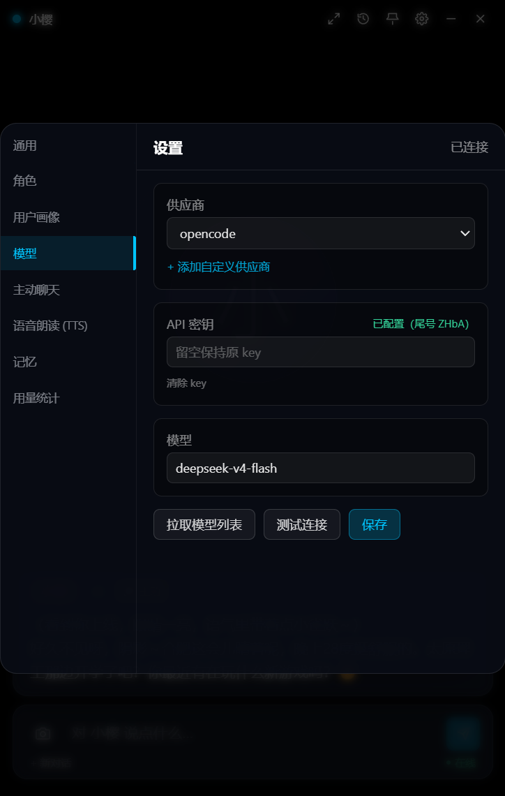
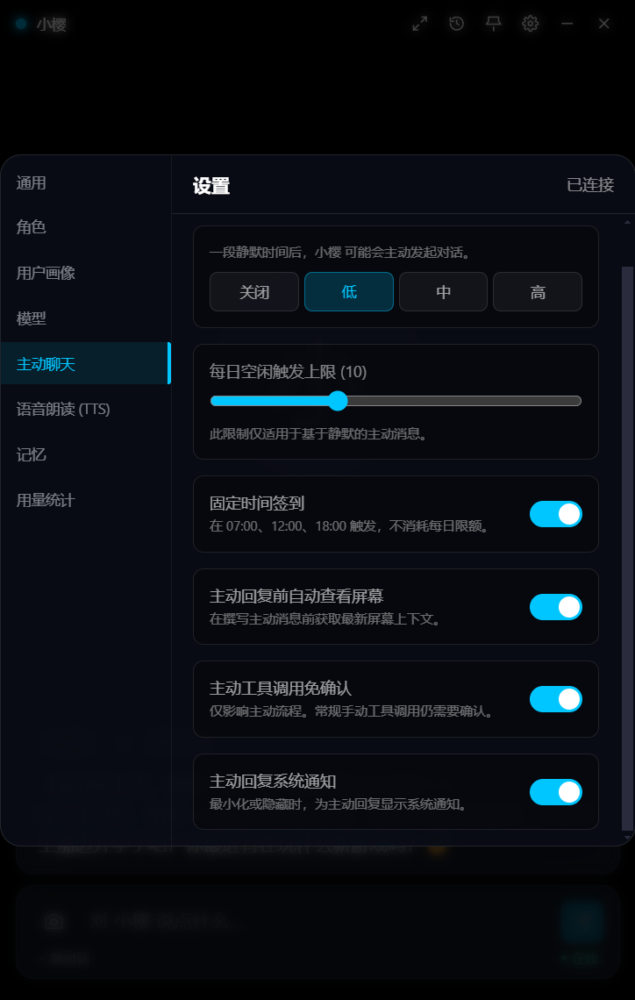

# ShadowProject

[中文](README.md) | English

A desktop AI companion. It lives on your desktop, reads and writes files, searches the web, looks at your screen, and remembers what you've told it across sessions. Multiple characters, group chat.

Backend: 93 Python modules, 14,257 lines (excluding tests). Frontend: Electron + React + TypeScript, 5,982 lines. 948 pytest cases, 12 ADRs, 31 specs, 39 eval cases. These move with development; this is the order of magnitude, not a live figure.

## Design notes

### Tool calls and approval

The model can't execute anything directly. Every tool call runs the whole chain:

```
assemble context → streaming call → parse tool request → user approval → async execution → feed result back
```

Approval is a serial gate: one request at a time, queued when several characters run concurrently, and a timeout or a dropped connection counts as a rejection. Ten built-in tools (read/write file, list directory, search files by name, time, screen, fetch URL, web search, memory read/write). External MCP tools come in over stdio or SSE, with tool names prefixed as `mcp__{server}__{tool}`. Long-running search is delegated to a SearchAgent sub-agent; the main loop chains at most 5 rounds.

### Reliability

Tool execution always goes through schema validation, circuit breaking, backoff retries and a timeout sandbox:

- Arguments that fail JSON Schema validation don't raise. They return an explanation so the model can fix the arguments and retry by itself.
- Retries are classified by error: 429 / 5xx are retryable, argument errors are not; whether a retry replays the operation depends on whether it's idempotent.
- The breaker is a CLOSED / OPEN / HALF_OPEN state machine. After repeated failures the tool gets isolated, and both the degraded and the recovery paths have tests.
- A tool is dropped from the round's tool list after two consecutive failures, and a substitute tool only gets one chance. Once everything is dropped, the model is asked to wrap up honestly instead of spinning. A user rejection doesn't count toward the failure budget but disables the tool all the same — a rejection means the model should change approach, not retry.

### Model capability table

Vision and native search aren't available on every model, so capabilities live in one model-level table ([ADR-0011](docs/adr/0011-provider-capability-matrix.md)): `supports_vision` / `image_api` / `native_search` / `search_api`. Onboarding a new model means filling in those two fields; behavioural differences are confined to configuration.

Unknown capabilities are deliberately asymmetric. An unknown `image_api` must raise: the user explicitly asked to look at the screen, and silently dropping the image isn't acceptable. An unknown `search_api` degrades to local scraping instead: search is an optional addition, and a missing config entry shouldn't interrupt the conversation.

### Concurrent group chat

Several characters think at the same time. The design is in [ADR-0009](docs/adr/0009-concurrent-group-turns.md); a few parts that weren't obvious:

- Arrival order under concurrency isn't speaking order, and the database timestamp isn't precise enough to break a tie. So each session gets a monotonic sequence number and every read path sorts by it.
- Waking excludes the speaker themselves, otherwise the model just continues its own last message.
- Cost is bounded by two limits (thinking rounds per member, total messages stored), with quota reserved before generation starts, so nothing is generated and then thrown away.
- In-flight generations are never cancelled. Each round re-reads the whole conversation, so messages stored mid-thinking naturally reach the next round's context.
- Scheduling state is only written by the parent task and child tasks return text only, so no locks are needed.

### Observability

Token usage is metered by session, character and model; every tool call is traced into a table. Logs go through a custom hub: stdout is teed into an in-memory ring buffer, a rotating file, and a live push to the frontend ([ADR-0002](docs/adr/0002-stdout-log-hub.md)).

## Vision and search

**Vision**: a screenshot goes out as an image content block with the current request, instead of being turned into a paragraph of text first. The old path lost information, cost an extra call every time, and depended on vision models that have since been retired. If the main model can't see images, an expert `VISION_*` model can act as fallback; with neither configured, `see_screen` says plainly that it can't see this time rather than making screen content up.

The rework also deleted a private adapter written for one specific MCP vision server, closing out [ADR-0010](docs/adr/0010-mcp-server-isolation.md). Spec: [`multimodal-vision(done)`](docs/specs/multimodal-vision(done).md).

**Search**: provider-native search comes first, degrading to a local scraping chain (duckduckgo → bing_web → searxng → bing). The old path was scraping only, where anti-bot measures, blocked networks or a page redesign could take the whole capability down, and citations weren't reliable. The implementation branches on `search_api`, never on provider name. Spec: [`native-web-search(done)`](docs/specs/native-web-search(done).md).

## Evaluation

39 cases in two layers, run differently:

- **Behavioural cases** run against a real model, asserting which tools were chosen, their arguments, and information that must appear in the answer. Coverage: 15 single-turn, 6 memory, 7 failure recovery, 2 vision, 3 search.
- **Invariant cases** cover non-deterministic systems like group chat: driven by a scripted fake model, asserting eight properties (thinking rounds per member, total message count, `<silent>` not persisted, monotonic sequence, and so on). They finish in seconds and cost no tokens.

Assertions only constrain what's decidable. Cases that can't be decided are marked `needs_review` and handed to a human, excluded from the pass rate — padding the denominator with undecidable cases makes the number look better and mean less.

The baseline records each case's result and token cost, versioned, and a rerun produces a diff. Otherwise a prompt change shows only "73% today" with no idea whether that's better or worse. See [ADR-0012](docs/adr/0012-eval-layering.md).

## Features

- **Long-term memory**: SQLite FTS5 full-text index plus vector embeddings, two-way recall fused with RRF. Memories are extracted automatically, deduplicated, decayed over time and isolated per character.
- **Multiple providers**: Anthropic's native SDK, OpenAI-compatible endpoints, and Gemini's native search and image APIs, all behind one streaming interface; format differences are confined to the per-provider formatters.
- **Voice**: GPT-SoVITS zero-shot voice cloning, a separate voice per character.
- **Proactive companion**: idle detection plus screen fingerprint dedup (dHash, Hamming ≤ 10 counts as the same screen), combined with time, weather and location to start a conversation.
- **Screen awareness**: screenshots are never written to disk or to the database, and only exist in memory for that one request.
- **Group chat**: several characters think at once, wake-ups are event-driven, and speaking order under concurrency is guaranteed by a per-session monotonic sequence number.

## Screenshots

| Token usage | Model configuration | Proactive companion |
|:---:|:---:|:---:|
|  |  |  |

## How it's built

- Every non-trivial decision gets an ADR (12 so far), recording the alternatives, the trade-off and the cost.
- New features start as a spec and get split into tickets (31 specs, 30 implemented and marked `(done)`; breakdowns live in `docs/Tickets/`).
- Important behaviour is pinned by tests: 948 cases today.
- Invariant tests first construct a violating scenario to confirm the assertion can actually fail, so they never assert something that's true by construction.
- Larger changes get a dedicated review written around them, under `docs/analysis/`; the three reviews from the group-chat concurrency round total about 90KB.
- The project is built with AI assistance (Claude Code / Codex / DeepSeek Harness); architecture, interface contracts, test design and code review are mine. A large share of those ~20k lines of source was AI-generated — the ADRs, specs and tests above are the constraints that keep it stable.

## Limitations

- Windows only. Screen capture uses `mss`, window exclusion relies on `WDA_EXCLUDEFROMCAPTURE`, and the floating window is Electron main-process logic.
- Single machine, single user, no accounts. Approval is a runtime constraint, not a permission system.
- Frontend components have a higher share of AI involvement than the backend; I own the UI requirements, interface contracts and acceptance.
- Two MCP test modules currently fail to collect because of a `pydantic` / `mcp` version conflict; the other 948 cases pass.
- No CI. Real-model evaluation is costly and non-deterministic, so only invariant cases are a good fit for a pipeline; a behavioural rerun is real spend, and day-to-day regression runs on the invariant layer.
- Voice requires a local GPT-SoVITS deployment and doesn't work out of the box.

## Stack

| Layer | Technology |
|---|---|
| Frontend | Electron + React 18 + TypeScript + Tailwind CSS + Zustand |
| Backend | Python 3.10+ / FastAPI + WebSocket + SQLAlchemy + aiosqlite |
| AI | Anthropic / OpenAI / DeepSeek / Gemini / Qwen / Zhipu / Moonshot |
| Retrieval | SQLite FTS5 + vector embeddings, RRF fusion |
| Voice | GPT-SoVITS zero-shot voice cloning |

## Project layout

```
├── backend/
│   ├── main.py              # FastAPI entry, tool registration, MCP setup
│   ├── core/                # agent loop, sub-agents, tool registry and runtime, breaker
│   ├── services/            # LLM, vision, memory, group orchestration, approval, retry, observability
│   ├── tools/               # files, search, screen, memory, time
│   ├── api/                 # REST + WebSocket routes (including tool_logs)
│   ├── models/              # SQLAlchemy ORM
│   └── eval/                # labelled test set, automatic scoring, baseline diff
├── frontend/
│   ├── electron/            # main process, preload, floating window
│   └── src/                 # components / hooks / stores / services / i18n
├── docs/
│   ├── adr/                 # architecture decision records (12)
│   ├── specs/               # feature specs, `(done)` once implemented
│   ├── analysis/            # focused technical reviews
│   └── Tickets/             # requirement breakdown
├── scripts/                 # dev.bat / install.bat / setup-tts.bat and other helpers
└── .env.example
```

## Getting started

### Requirements

- Windows 10/11
- Python 3.10+ (3.10.6 recommended)
- Node.js 18+
- [Optional] NVIDIA GPU + GPT-SoVITS (voice)

### Install

```bash
scripts\install.bat
```

Or manually:

```bash
cd backend && pip install -r requirements.txt
cd frontend && npm install
```

### Configuration

```bash
cp .env.example .env
```

`LLM_API_KEY` is the only required entry; the rest are optional. The full list is in `.env.example`:

| Key | Description |
|---|---|
| `LLM_*` | provider, model, base_url, api_key for the chat model |
| `VISION_*` | expert vision model, a fallback when the main model can't see images |
| `SEARCH_BACKEND` | preferred backend for the local scraping chain: duckduckgo / bing_web / searxng / bing (duckduckgo by default) |
| `AMAP_API_KEY` | Amap key (location + weather, free) |
| `TTS_REF_BASE` | GPT-SoVITS install path |
| `MAX_CONTEXT_TOKENS` | context window; 16000 in `.env.example`, 8000 as the code default |

### Run

```bash
scripts\dev.bat                      # start both

# or separately
cd backend && python main.py         # backend :8722
cd frontend && npm run electron:dev  # frontend :16173
```

### Voice (optional)

```bash
scripts\setup-tts.bat
```

This clones the repo, creates a virtualenv, installs PyTorch and dependencies, and downloads the pretrained models. If the model download fails, search for a "GPT-SoVITS 整合包" package on Bilibili and download it manually.

To clone a voice for a character: prepare a clean 3-10 second single-speaker clip (no BGM, no noise), put it in the GPT-SoVITS directory and note down what the clip says; start `runtime\python.exe api_v2.py` from the GPT-SoVITS directory; then point the character at the audio path and its transcript. Recommended parameters: `temperature=0.6`, `top_k=30`, `text_split_method=cut5`.

A neutral, gentle reference clip works best, ideally 5-8 seconds. A Japanese voice sample can also clone into Chinese speech (set `prompt_lang` to `ja`).

### Screen understanding

If the main model supports vision, nothing needs configuring: the screenshot from "look at my screen" goes straight into that turn's request. If it can't see images, fill in a set of `VISION_*` values (provider / model / base_url / api_key) in `.env` to use an expert vision model as fallback. With neither configured, `see_screen` says plainly that it can't see this time.

## Docs

| Directory | Contents |
|---|---|
| [`docs/adr/`](docs/adr) | architecture decision records; start with [0009 group chat concurrency](docs/adr/0009-concurrent-group-turns.md), [0011 capability table](docs/adr/0011-provider-capability-matrix.md) and [0012 eval layering](docs/adr/0012-eval-layering.md) |
| [`docs/specs/`](docs/specs) | feature specs; a `(done)` suffix means implemented |
| [`docs/analysis/`](docs/analysis) | focused reviews, including the three group-chat concurrency reviews and an architecture retrospective |
| [`docs/Tickets/`](docs/Tickets) | requirement breakdown and progress |

## License

MIT
