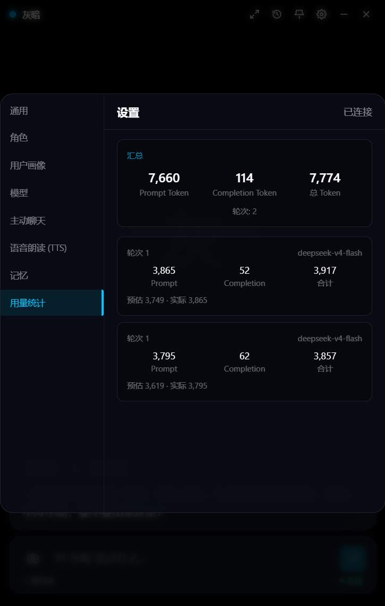
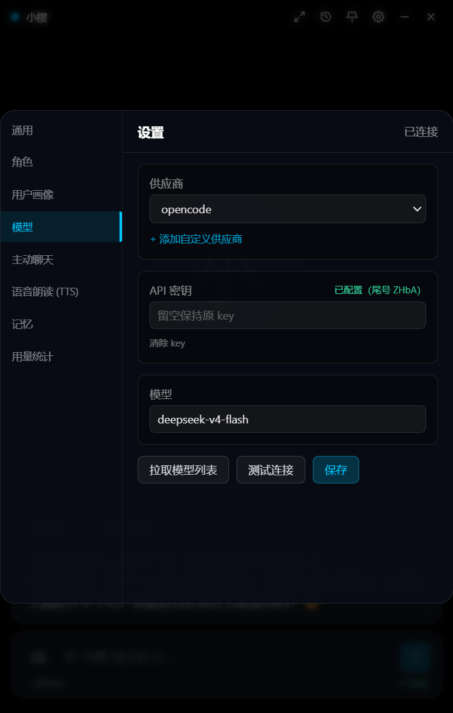
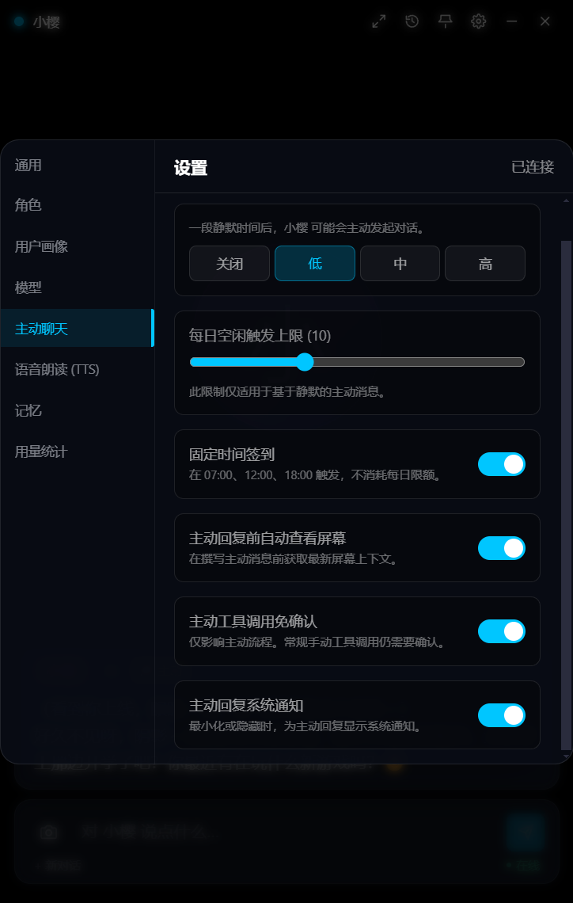

# ShadowProject

[English](README.en.md) | 中文

桌面 AI 伙伴。常驻桌面，能读写文件、联网搜索、看屏幕、跨会话记住你说过的事，支持多角色和群聊。

后端 93 个 Python 模块、14,257 行（不含测试），前端 Electron + React + TypeScript 5,982 行。948 个 pytest 用例，12 篇 ADR，31 篇 spec，39 条评测用例。数字随开发变动，这里只给量级。

## 设计要点

### 工具调用与审批

模型不能直接执行任何东西。一次工具调用走完整条链路：

```
装配上下文 → 流式调用 → 解析工具请求 → 用户审批 → 异步执行 → 结果回环
```

审批是串行闸门，同一时刻只放行一个，多角色并发时排队出现，超时或连接断开按拒绝处理。内置 10 个工具（文件读写、列目录、按文件名搜索、时间、屏幕、抓网页、联网检索、记忆查询与保存）；MCP 外部工具以 stdio / SSE 两种传输接入，工具名加 `mcp__{server}__{tool}` 前缀做隔离。长程搜索交给 SearchAgent 子智能体，主循环最多 5 轮链式调用。

### 可靠性

工具执行统一经过参数校验、熔断、退避重试、超时沙箱：

- 参数不符合 JSON Schema 时不直接报错，返回一段说明让模型自己改参数重试。
- 重试按错误分类，429 / 5xx 可以重试，参数错误不重试；能否重放看操作是否幂等。
- 熔断是 CLOSED / OPEN / HALF_OPEN 状态机，连续失败后隔离该工具，降级和恢复行为都有测试。
- 同一工具连续失败两次就从本轮工具列表里摘掉，替代工具只给一次机会；全部摘完后让模型直接收尾说明，而不是继续空转。用户主动拒绝不计入失败次数，但同样停用该工具——拒绝意味着模型该换路子，不是该重试。

### 模型能力表

视觉和原生搜索不是每个模型都有，能力用一个模型级表描述（[ADR-0011](docs/adr/0011-provider-capability-matrix.md)）：`supports_vision` / `image_api` / `native_search` / `search_api`。接入新模型只填这两个字段，行为差异收敛在配置里。

未知能力刻意做成不对称的：不认识的 `image_api` 直接报错——用户明确要求看屏幕，静默丢图不可接受；不认识的 `search_api` 降级到本地抓取——搜索是可选增强，不该因为配置缺项打断对话。

### 群聊并发

多个角色同时思考。设计写在 [ADR-0009](docs/adr/0009-concurrent-group-turns.md)，几处不太直观的地方：

- 并发到达的顺序和发言顺序不一致，数据库时间戳精度又不足以区分先后，于是引入会话内单调序号，读路径全部改按序号排序。
- 唤醒时排除说话者本人，否则模型会接着自己刚说的话继续说。
- 成本用两道上限约束（每成员思考轮数、全局消息条数），额度在发起前预留，避免生成完再丢弃。
- 在途生成不取消，每轮重读整段对话，思考期间落库的消息会进入下一轮上下文。
- 调度状态只由父任务改写、子任务只返回文本，所以并发下没有加锁。

### 可观测

token 消耗按会话、角色、模型计量，工具调用全量 tracing 落表。日志走自建的枢纽：劫持 stdout 做 tee，进内存环形缓冲，同时写轮转文件并实时推给前端（[ADR-0002](docs/adr/0002-stdout-log-hub.md)）。

## 视觉与搜索

**视觉**：截图作为图片内容块随当轮请求发给主模型，不再先转成一段文字描述。原先那条路信息有损、每次多一次调用，依赖的几个视觉模型也已停用。主模型看不了图时可以配一个 `VISION_*` 专家视觉模型兜底；两个都没有时 `see_screen` 明确说这次看不了，不编造屏幕内容。

这条改造顺带删掉了一段只为单个 MCP vision server 写的参数名适配，收尾了 [ADR-0010](docs/adr/0010-mcp-server-isolation.md)。spec 见 [`multimodal-vision(done)`](docs/specs/multimodal-vision(done).md)。

**搜索**：provider 原生搜索优先，失败降级到本地抓取链（duckduckgo → bing_web → searxng → bing）。原先只有本地抓取，反爬、被墙、页面改版都会让整块能力失效，也拿不到可靠引用。实现按 `search_api` 分叉，不按厂商名写 if。spec 见 [`native-web-search(done)`](docs/specs/native-web-search(done).md)。

## 评测

39 条用例分两类，跑法不同：

- **行为类**用真模型跑，断言工具选择、调用参数和回答里必须出现的信息。覆盖单轮 15 条、记忆 6 条、失败恢复 7 条、视觉 2 条、搜索 3 条。
- **不变量类**针对群聊这类非确定系统：脚本化假模型驱动，断言每成员思考轮数、全局消息条数、`<silent>` 不落库、序号单调等 8 条，秒级跑完、不消耗 token。

断言只约束能判定的东西。判断不了的用例标成 `needs_review` 显式移交人工，不计入通过率——把判不了的塞进分母，数字好看但没有意义。

基线按版本记录每条用例的结果和 token 成本，重跑时给 diff，否则只看到「今天 73%」，不知道比上次好还是坏。分层设计见 [ADR-0012](docs/adr/0012-eval-layering.md)。

## 功能

- **长期记忆**：SQLite FTS5 全文索引加向量嵌入双路召回，RRF 融合排序。记忆自动提取、去重、按时间衰减、按角色隔离。
- **多 provider**：Anthropic 原生 SDK、OpenAI 兼容协议，以及 Gemini 的原生搜索与图片接口，统一到同一套流式接口，格式差异收敛在各家的 formatter 里。
- **语音**：GPT-SoVITS 零样本克隆，每个角色独立音色。
- **主动陪伴**：空闲检测加屏幕指纹去重（dHash，Hamming ≤ 10 视为同一屏），结合时间、天气、位置发起话题。
- **屏幕感知**：截图不落盘、不落库，只存在于当轮请求的内存里。
- **群聊**：多角色同时思考、事件唤醒，并发下的发言顺序由会话内单调序号保证。

## 界面预览

| Token 用量统计 | 多供应商模型配置 | 主动陪伴 |
|:---:|:---:|:---:|
|  |  |  |

## 工程方法

- 每个非平凡决策写 ADR（现有 12 篇），记录备选方案、取舍和代价。
- 新功能先写 spec 再拆 ticket（31 篇 spec，30 篇已实现并在文件名上标 `(done)`，拆解在 `docs/Tickets/`）。
- 关键行为用测试固定，当前 948 个用例。
- 不变量类测试先构造违规场景、确认断言本身能红，避免写出永远为真的断言。
- 大改前后写专项审查，放在 `docs/analysis/`，群聊并发那轮的三份合计约 90KB。
- 项目采用 AI 辅助开发（Claude Code / Codex / DeepSeek Harness），架构、接口契约、测试设计与代码评审由我负责。源码约 2 万行里 AI 生成的占比不低，上面这些 ADR、spec 和测试就是让它稳定下来的约束。

## 局限

- 只做了 Windows。屏幕采集用 `mss`，窗口排除依赖 `WDA_EXCLUDEFROMCAPTURE`，浮动窗是 Electron 主进程逻辑。
- 单机单用户，没有账号体系。审批是运行时约束，不是权限系统。
- 前端组件代码的 AI 参与度高于后端，我负责界面需求、接口契约和验收。
- 两个 MCP 测试模块受 `pydantic` 与 `mcp` 的版本冲突影响暂时无法收集，其余 948 个用例全绿。
- 没有 CI。真模型评测有成本和随机性，只有不变量用例适合进流水线；行为类用例重跑是一次实际开销，平时靠不变量层做回归。
- 语音依赖本地部署 GPT-SoVITS，不是开箱即用。

## 技术栈

| 层 | 技术 |
|---|---|
| 前端 | Electron + React 18 + TypeScript + Tailwind CSS + Zustand |
| 后端 | Python 3.10+ / FastAPI + WebSocket + SQLAlchemy + aiosqlite |
| AI | Anthropic / OpenAI / DeepSeek / Gemini / 通义 / 智谱 / Moonshot 多 provider |
| 检索 | SQLite FTS5 + 向量嵌入，RRF 融合 |
| 语音 | GPT-SoVITS 零样本声线克隆 |

## 项目结构

```
├── backend/
│   ├── main.py              # FastAPI 入口、工具注册、MCP 初始化
│   ├── core/                # Agent 主循环、子智能体、工具注册表与运行时、熔断
│   ├── services/            # LLM、视觉、记忆、群聊编排、审批门、重试、可观测
│   ├── tools/               # 文件、搜索、屏幕、记忆、时间
│   ├── api/                 # REST + WebSocket 路由（含 tool_logs）
│   ├── models/              # SQLAlchemy ORM
│   └── eval/                # 标注测试集 + 自动跑分 + 基线 diff
├── frontend/
│   ├── electron/            # 主进程、preload、浮动窗口
│   └── src/                 # components / hooks / stores / services / i18n
├── docs/
│   ├── adr/                 # 架构决策记录（12 篇）
│   ├── specs/               # 功能规格，实现完标 (done)
│   ├── analysis/            # 专项技术审查
│   └── Tickets/             # 需求拆解
├── scripts/                 # dev.bat / install.bat / setup-tts.bat 等
└── .env.example
```

## 快速开始

### 环境要求

- Windows 10/11
- Python 3.10+（推荐 3.10.6）
- Node.js 18+
- [可选] NVIDIA GPU + GPT-SoVITS（语音功能）

### 安装

```bash
scripts\install.bat
```

或手动安装：

```bash
cd backend && pip install -r requirements.txt
cd frontend && npm install
```

### 配置

```bash
cp .env.example .env
```

至少填 `LLM_API_KEY`，其余可选。完整配置项见 `.env.example`：

| 配置 | 说明 |
|---|---|
| `LLM_*` | 对话模型的 provider、model、base_url、api_key |
| `VISION_*` | 专家视觉模型，主模型看不了图时兜底 |
| `SEARCH_BACKEND` | 本地抓取链的首选后端：duckduckgo / bing_web / searxng / bing（默认 duckduckgo） |
| `AMAP_API_KEY` | 高德 Key（位置 + 天气，免费） |
| `TTS_REF_BASE` | GPT-SoVITS 安装路径 |
| `MAX_CONTEXT_TOKENS` | 上下文窗口，`.env.example` 默认 16000（代码内默认 8000） |

### 启动

```bash
scripts\dev.bat                      # 一键启动

# 或分别启动
cd backend && python main.py         # 后端 :8722
cd frontend && npm run electron:dev  # 前端 :16173
```

### 语音（可选）

```bash
scripts\setup-tts.bat
```

自动完成克隆仓库、虚拟环境、PyTorch、依赖和预训练模型下载。模型下载失败的话，去 B 站搜 "GPT-SoVITS 整合包" 手动下载。

给角色克隆声线：准备一段 3-10 秒干净单人音频（无 BGM、无噪音），放到 GPT-SoVITS 目录并记下音频说的文本；在 GPT-SoVITS 目录启动 `runtime\python.exe api_v2.py`；把音频路径和对应文本配置给角色。推荐参数 `temperature=0.6`、`top_k=30`、`text_split_method=cut5`。

参考音频选中性、温柔语调，长度 5-8 秒最佳；日语音源也能克隆出中文声音（`prompt_lang` 设为 `ja`）。

### 屏幕理解

主模型自己支持视觉时什么都不用配，「看看我屏幕」的截图直接进当轮请求。主模型看不了图时，在 `.env` 里填一组 `VISION_*`（provider / model / base_url / api_key）走专家视觉模型兜底。两样都没配时，`see_screen` 会明确回一句这次看不了。

## 文档

| 目录 | 内容 |
|---|---|
| [`docs/adr/`](docs/adr) | 架构决策记录，建议从 [0009 群聊并发](docs/adr/0009-concurrent-group-turns.md)、[0011 能力表](docs/adr/0011-provider-capability-matrix.md)、[0012 评测分层](docs/adr/0012-eval-layering.md) 看起 |
| [`docs/specs/`](docs/specs) | 功能规格，`(done)` 后缀表示已实现 |
| [`docs/analysis/`](docs/analysis) | 专项审查，含群聊并发三轮审查与架构复盘 |
| [`docs/Tickets/`](docs/Tickets) | 需求拆解与进度 |

## License

MIT
